# Student Management Portal

**U21CS501 Web Technology - Assignment II** (III Year, Semester V)

One coherent portal built in three layers that share **one MySQL database and one private file store**:

| Question | Module | Technology | Folder |
|---|---|---|---|
| Q1 (8 marks) | Student registration form | HTML5, CSS3, vanilla JavaScript | [`frontend/`](frontend/) |
| Q2 (16 marks) | Admin panel: student CRUD, uploads, file metadata | PHP 8 (PDO), MySQL | [`php-admin/`](php-admin/) |
| Q3 (16 marks) | Profile portal: dynamic profiles, file streaming, sessions | Java Servlets, JSP/JSTL, JDBC, Maven WAR | [`java-servlet/`](java-servlet/) |
| Shared | Schema, sample data, demo files | MySQL / MariaDB | [`database/`](database/) |

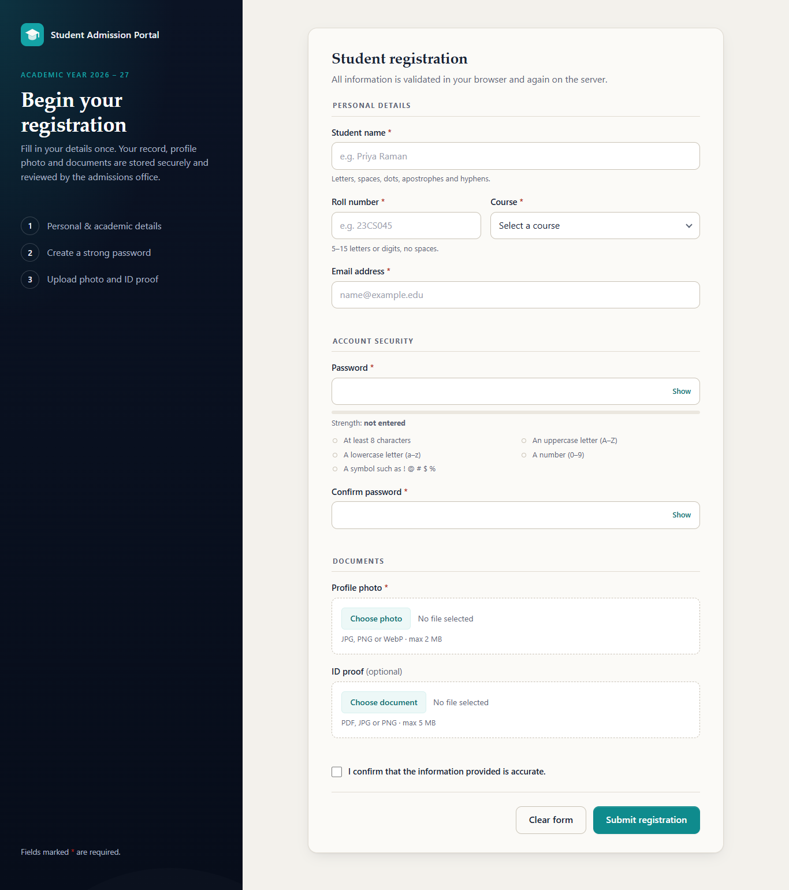

---

## Contents
1. [Features](#features)
2. [Architecture](#architecture)
3. [Screenshots](#screenshots)
4. [Quick start (Windows + XAMPP)](#quick-start-windows--xampp)
5. [Application URLs](#application-urls)
6. [Project structure](#project-structure)
7. [Documentation](#documentation)

---

## Features

### Q1 - Registration form ([`frontend/register.html`](frontend/register.html))
- Semantic HTML5 form: name, roll number, email, course, password + confirmation, profile photo, optional ID proof, declaration.
- Accessible: `<label for>`, `fieldset/legend`, `aria-invalid`, `aria-describedby`, live regions, error summary with links, skip link, keyboard-usable file pickers.
- Custom CSS3 design (no framework): navy brand panel, warm-white card, teal accents, focus rings, error/success states, responsive down to 360 px.
- JavaScript validation ([`frontend/js/validation.js`](frontend/js/validation.js)): required fields, email format, roll-number pattern, **password strength meter** with a live checklist, password confirmation, **file type (extension + MIME + real magic bytes), file size**, duplicate-submit protection, AJAX submission with server error mapping.
- Submits to a PHP endpoint that **repeats every check on the server** and creates the student, a student login and the uploaded files.

### Q2 - PHP admin panel ([`php-admin/`](php-admin/))
- Admin login (bcrypt, session ID regeneration, idle timeout, POST+CSRF logout).
- Dashboard, searchable/sortable/paginated student list, add, view, edit, delete (with confirmation dialog and a no-JavaScript fallback page).
- Uploads of profile photos and documents (ID proof, certificate, marksheet, other), stored under `storage/uploads/students/<id>/<category>/<random-hex>.<ext>`.
- Metadata in MySQL: student ID, original name, generated name, relative path, detected MIME type, size, SHA-256, uploader, upload date, category.
- Server-side file checks: size limit, **real content type via `finfo`**, image decoding, PDF header, embedded-code detection, never trusting client name/MIME/extension.
- Images and documents displayed on the profile; files streamed only through the authenticated `file.php`.

### Q3 - Java Servlet portal ([`java-servlet/`](java-servlet/))
- Maven WAR, Servlet 3.1 / JSP 2.3 (`javax.*`, matches XAMPP's Tomcat 8.5, also runs on Tomcat 9).
- Layers: `model` → `dao` (JDBC, prepared statements only) → `servlet` → JSP views, plus `filter`, `listener` and `util` (`DatabaseUtil`, `AppConfig`, `PasswordUtil`, `StoragePaths`, `WebUtil`).
- Lists students with `<c:forEach>`, renders 0 / 1 / many files with `<c:choose>`, `` served by `FileServlet`.
- `FileServlet` streams images and documents with correct `Content-Type`, `Content-Length` and a safe `Content-Disposition`.
- Login with the **same accounts** as PHP (verifies PHP's bcrypt hashes), session ID change on login, idle timeout, logout invalidates the session.
- Roles: `admin`/`staff` see every profile; a `student` sees only their own profile and files.

---

## Architecture

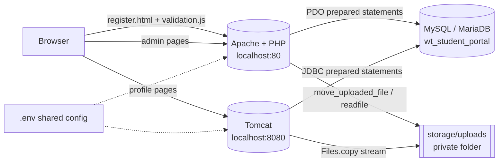

- **Shared database**: `courses`, `students`, `users`, `student_files` ([`database/schema.sql`](database/schema.sql)).
- **Shared storage**: PHP writes files, both PHP (`file.php`) and Java (`FileServlet`) stream them. The folder is outside every public web root and denied by `.htaccess`.
- **Shared configuration**: one `.env` file read by PHP ([`config.php`](php-admin/config/config.php)) and Java ([`AppConfig.java`](java-servlet/src/main/java/edu/webtech/portal/util/AppConfig.java)).
- **Separate sessions**: PHP and Java each have their own login and session cookie (`SMP_ADMIN_SESSION`, `SMP_PORTAL_SESSION`). They are *not* shared; each application protects its own endpoints.

---

## Screenshots

All screenshots are real captures of the running applications (see [`screenshots/README.md`](screenshots/README.md) for the full list of 35).

| | |
|---|---|
| 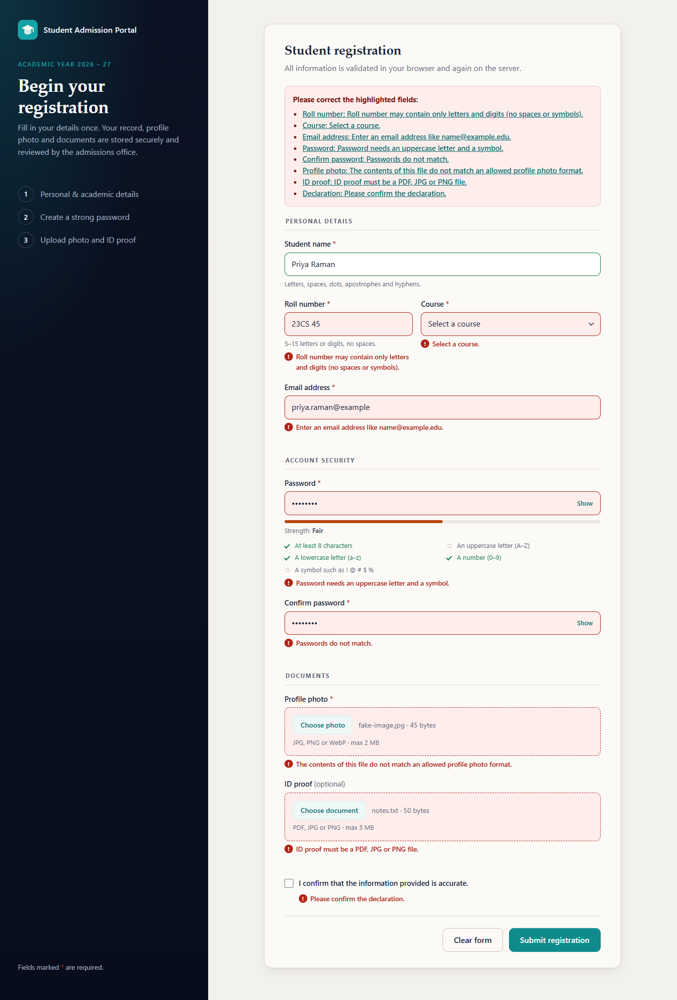 Registration validation | 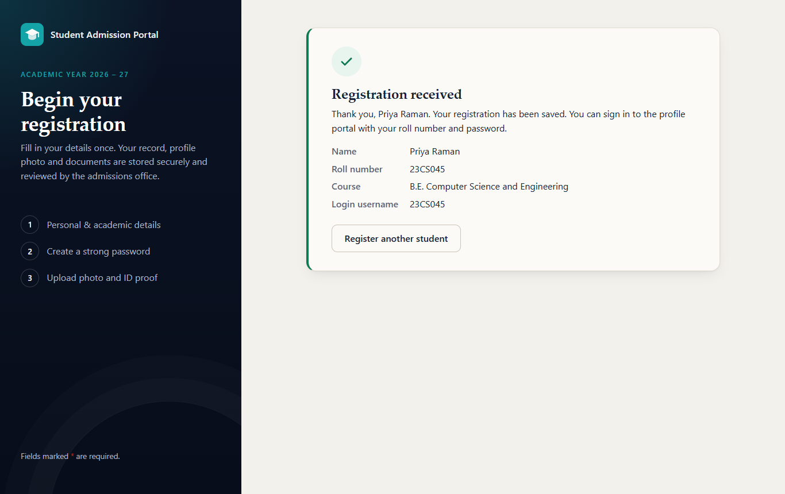 Server accepted registration |
| 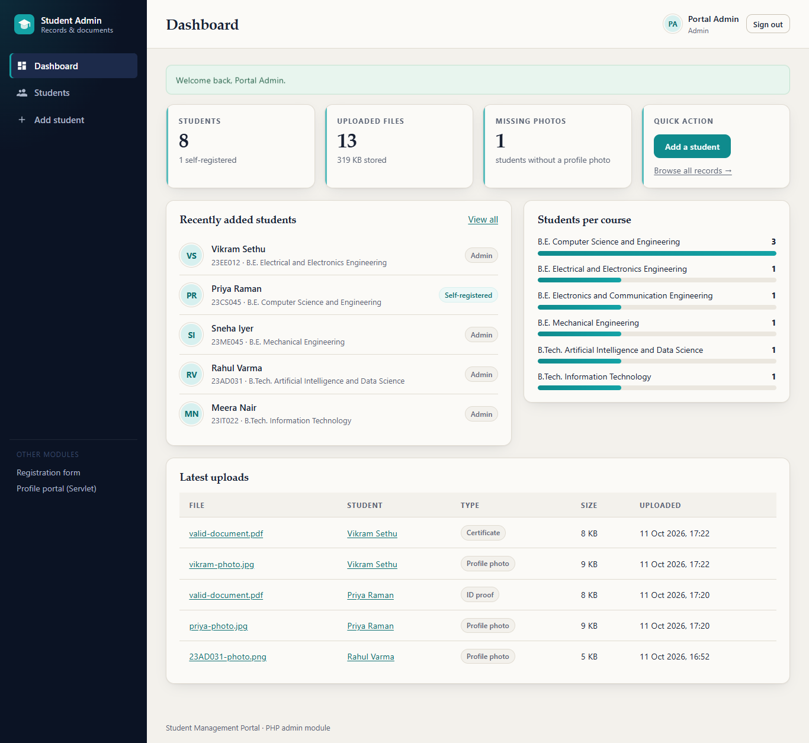 PHP admin dashboard | 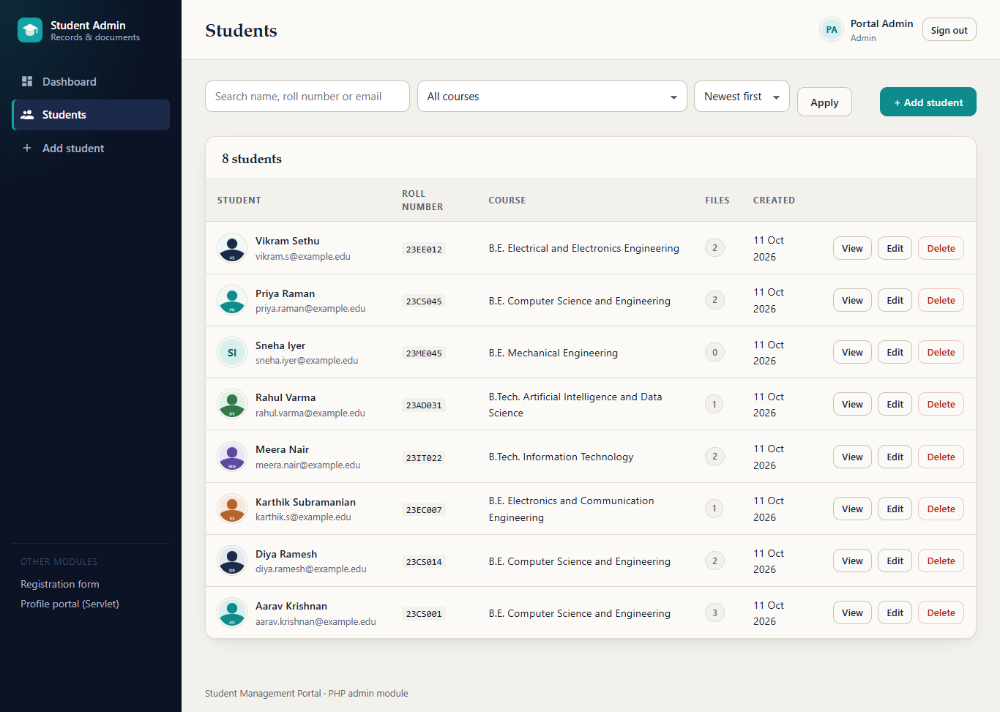 PHP student list |
| 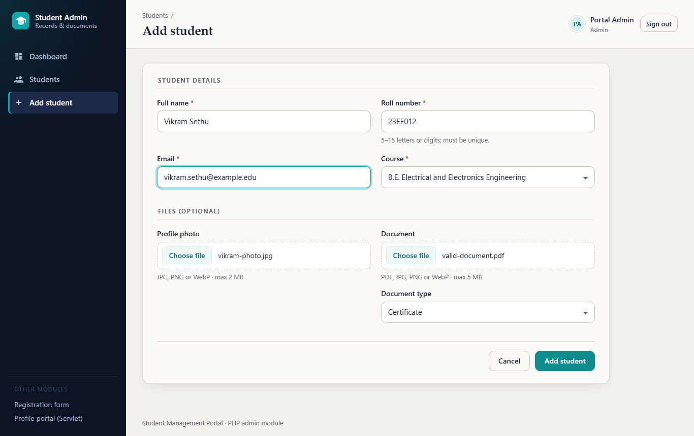 Add student with uploads | 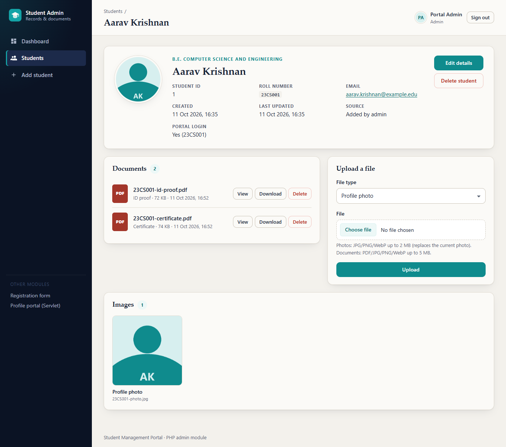 PHP profile with image + documents |
| 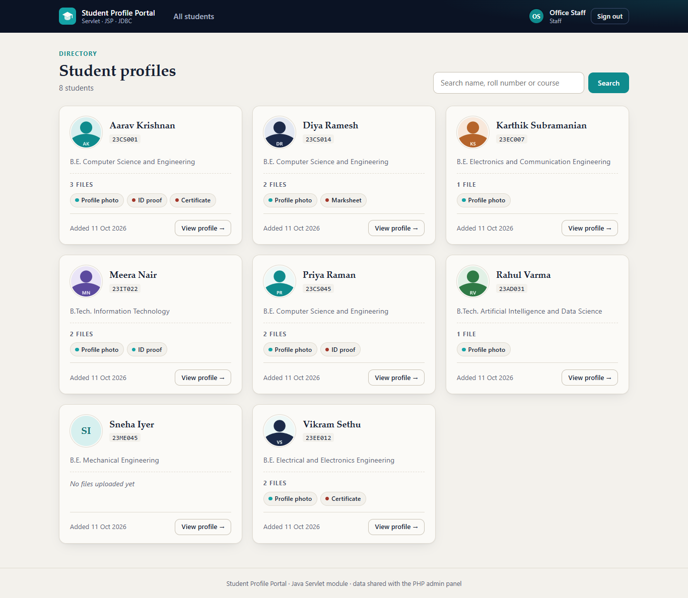 Servlet/JSP student list | 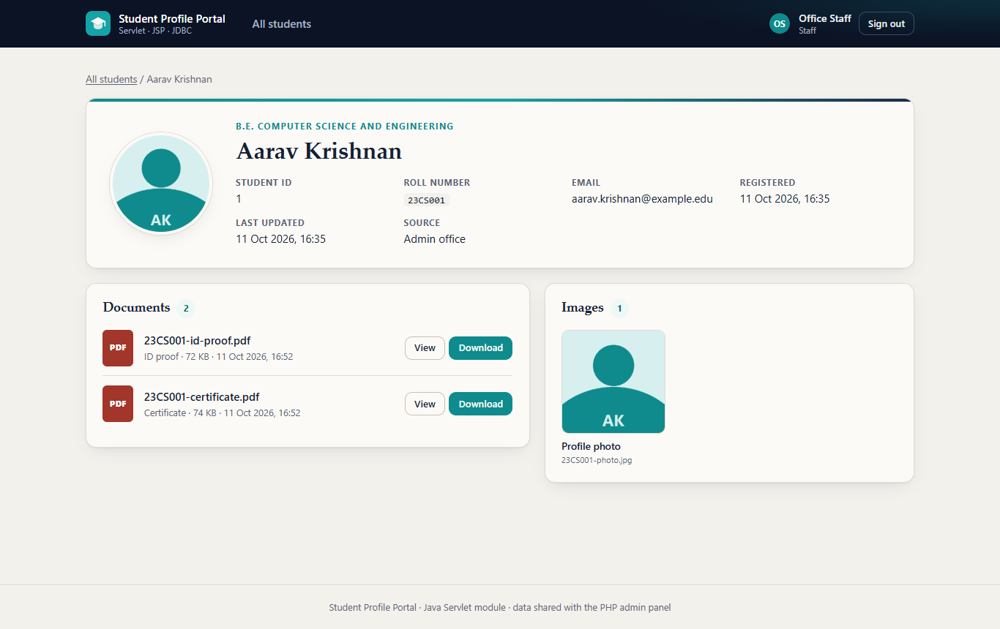 Servlet profile, images via Servlet |
| 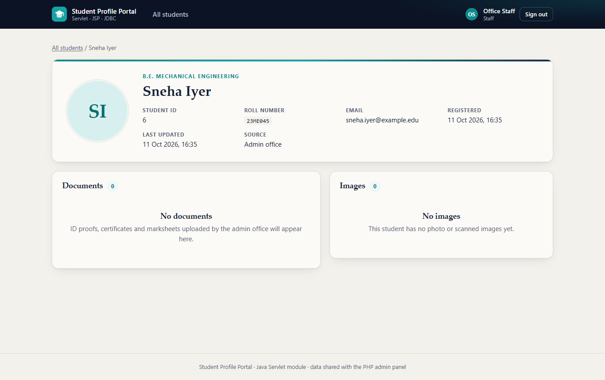 Student with zero files | 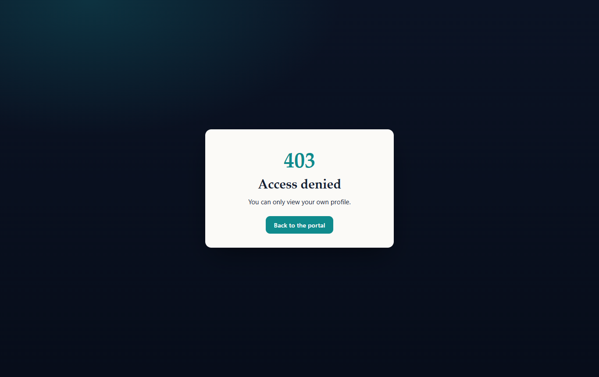 Student blocked from another profile |

---

## Quick start (Windows + XAMPP)

Full step-by-step instructions, including VS Code and troubleshooting: **[docs/SETUP.md](docs/SETUP.md)**.

**Prerequisites:** XAMPP (Apache, PHP 8.1+, MariaDB/MySQL; its bundled Tomcat 8.5 works), JDK 11+ (tested with JDK 24). Maven is **not** needed (the Maven Wrapper downloads it). Python 3 + `requests` only for the automated tests.

```powershell
# 1. Database: schema + sample data (run from the project folder, MySQL running in XAMPP)
C:\xampp\mysql\bin\mysql.exe -u root -p < database\schema.sql
C:\xampp\mysql\bin\mysql.exe -u root -p wt_student_portal < database\sample_data.sql

# 2. Low-privilege DB user: copy database\create_app_user.sql.example, set a password, run it
C:\xampp\mysql\bin\mysql.exe -u root -p < database\create_app_user.local.sql

# 3. Configuration: copy the template and put the same DB password in it
copy .env.example .env

# 4. First admin account (you choose the password - nothing is hard-coded)
C:\xampp\php\php.exe php-admin\bin\create_user.php --role=admin --username=admin --name="Portal Admin"

# 5. Demo files for the sample students (goes through the real upload validator)
C:\xampp\php\php.exe php-admin\bin\seed_sample_files.php

# 6. Serve the project with XAMPP's Apache (junction = no copying)
cmd /c mklink /J C:\xampp\htdocs\wt-portal C:\path\to\this\project

# 7. Build + deploy the Servlet module to Tomcat, then start Tomcat from the XAMPP control panel
java-servlet\deploy-tomcat.bat
```

## Application URLs

| Module | URL | Who |
|---|---|---|
| Landing page | http://localhost/wt-portal/ | everyone |
| **Q1** Registration form | http://localhost/wt-portal/frontend/register.html | public |
| **Q2** PHP admin panel | http://localhost/wt-portal/php-admin/public/ | role `admin` |
| **Q3** Servlet profile portal | http://localhost:8080/student-portal-servlet/ | roles `admin`, `staff`, `student` |

The PHP URLs are served by **Apache on port 80**; the Servlet URLs by **Tomcat on port 8080**.

Accounts: create them with `php-admin/bin/create_user.php` (`--role=admin|staff|student`). Students who register through the form can sign in to the Servlet portal with their **roll number** and password.

---

## Project structure

```
WT_Assi2/
├── frontend/                 Q1: index.html, register.html, css/style.css, js/validation.js, tests/
├── php-admin/                Q2
│   ├── config/config.php     reads the shared .env
│   ├── includes/             bootstrap, Auth, Csrf, Session, Database, Validator, FileStorage,
│   │                         Repositories, StudentService, helpers, views/
│   ├── public/               the ONLY web-reachable PHP folder (pages, file.php, register.php, assets)
│   ├── bin/                  create_user.php, delete_user.php, seed_sample_files.php (CLI)
│   └── tests/run_tests.php   PHP test suite
├── java-servlet/             Q3: pom.xml, mvnw(.cmd), deploy-tomcat.bat
│   └── src/main/java/edu/webtech/portal/{model,dao,servlet,filter,listener,util}
│       src/main/webapp/WEB-INF/{web.xml,views/*.jsp}, assets/
│       src/test/java/...     JUnit 5 tests
├── database/                 schema.sql, sample_data.sql, create_app_user.sql.example, sample-files/
├── storage/uploads/          uploaded files (git-ignored, private)
├── tests/                    e2e_test.py, capture_screenshots.py, generate_fixtures.py, fixtures/
├── screenshots/              35 real screenshots
├── docs/                     SETUP, TESTING, CODE_EXPLANATION, CONCLUSION, FINAL_AUDIT
├── .env.example              configuration template (.env itself is never committed)
└── README.md
```

## Documentation
- [docs/SETUP.md](docs/SETUP.md) - installation on Windows (XAMPP, VS Code, Tomcat, Maven wrapper)
- [docs/TESTING.md](docs/TESTING.md) - every test suite, how to run it, real results
- [docs/CODE_EXPLANATION.md](docs/CODE_EXPLANATION.md) - files, tables, upload flow, sessions, JDBC, streaming
- [docs/CONCLUSION.md](docs/CONCLUSION.md) - conclusion
- [docs/FINAL_AUDIT.md](docs/FINAL_AUDIT.md) - requirement-by-requirement audit against the rubric
