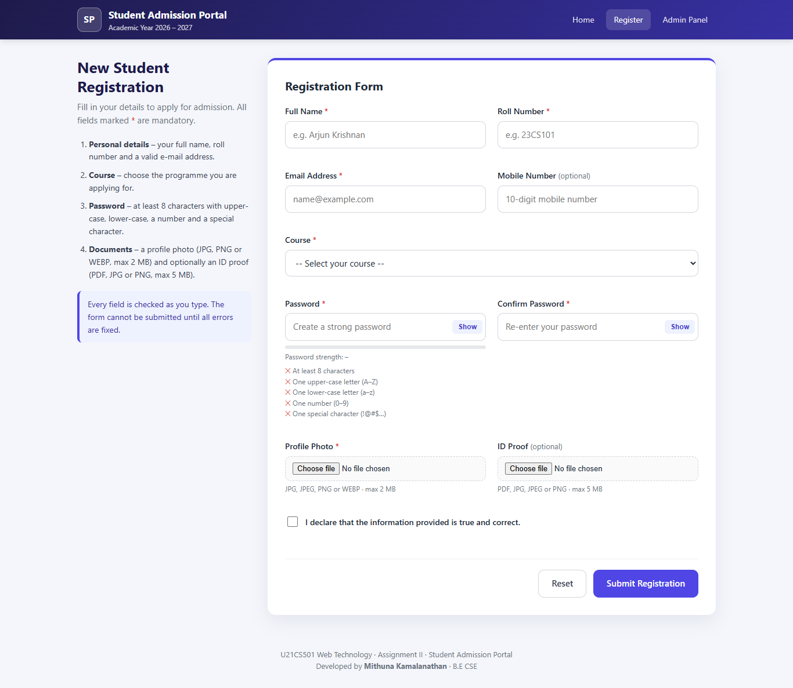
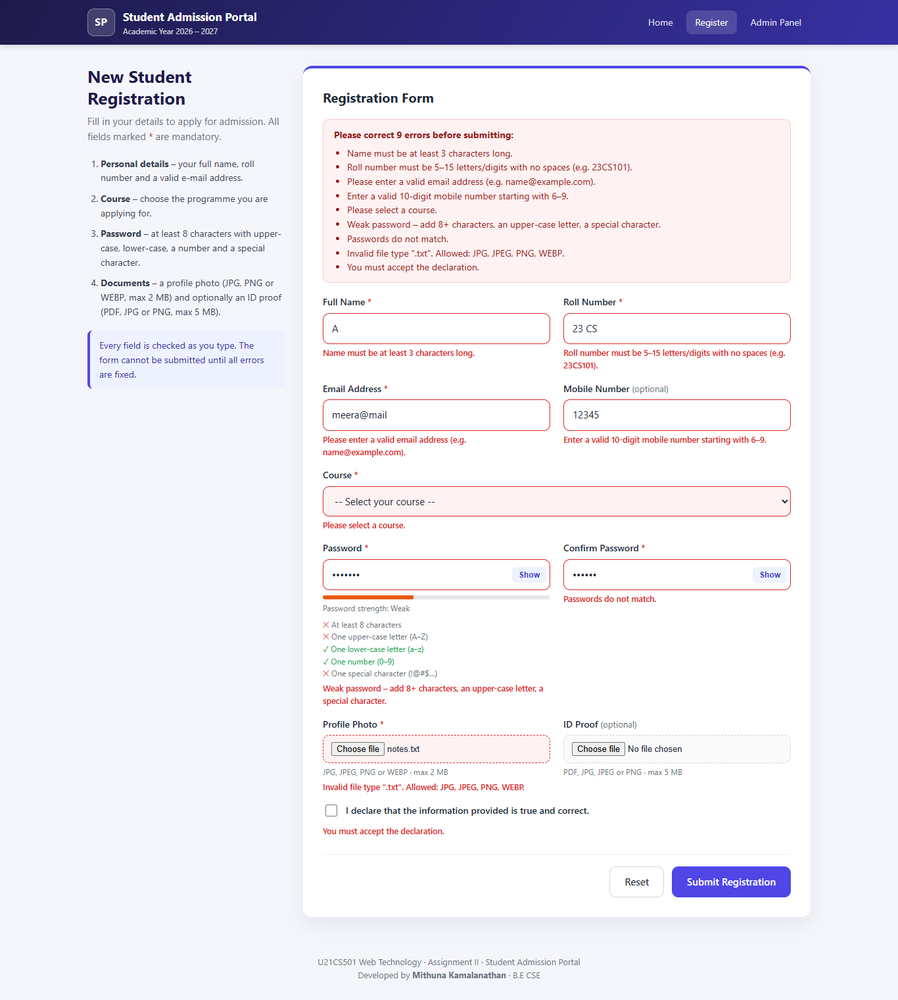
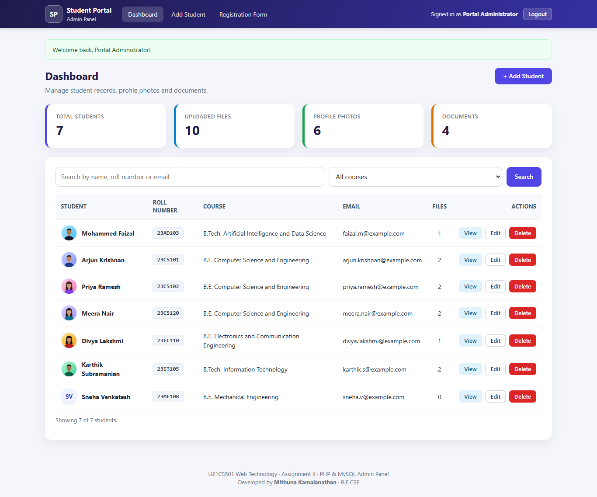
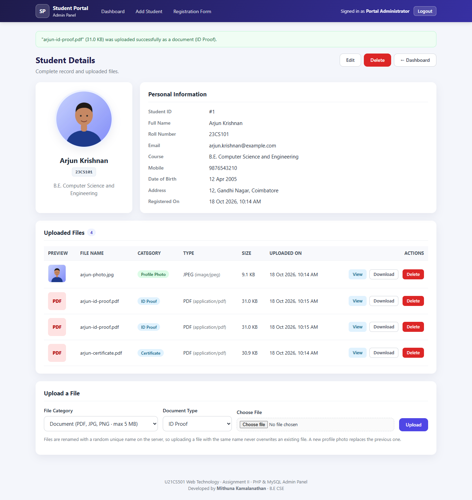
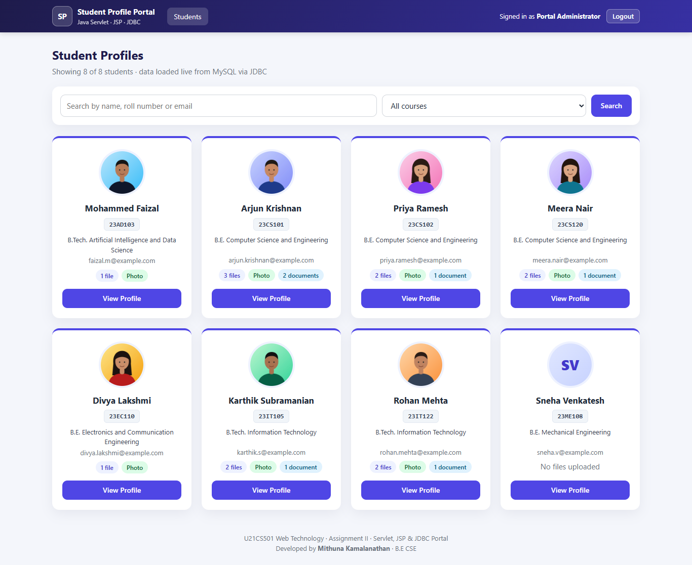
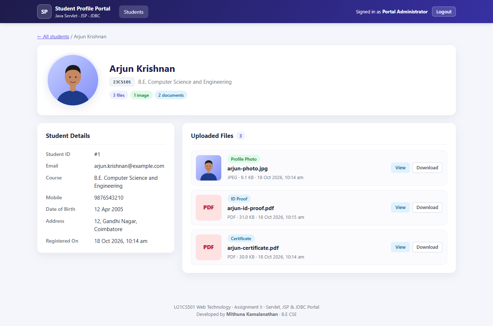

# Student Portal – Web Technology Assignment II

**Student details:**
- Name: Mithuna Kamalanathan
- Roll Number: 24CS117
- Course: B.E CSE

**Course:** U21CS501 Web Technology · **Assignment:** II (40 marks) · **Academic Year:** 2026 – 2027

**Submission report (PDF):** [`Mithuna_Kamalanathan_24CS117_Web_Technology_Assignment_II_FINAL.pdf`](Mithuna_Kamalanathan_24CS117_Web_Technology_Assignment_II_FINAL.pdf)

A complete, locally runnable student admission portal built in three clearly separated modules that all share **one MySQL database**:

| Module | Question | Technology | Folder |
|---|---|---|---|
| Student registration form | Q1 – Frontend (8 marks) | HTML5, CSS3, JavaScript | [`Question1_Frontend/`](Question1_Frontend/) |
| Admin panel – CRUD + file uploads | Q2 – PHP & MySQL (16 marks) | PHP 8 (PDO), MySQL / MariaDB | [`Question2_PHP/`](Question2_PHP/) |
| Student profile portal | Q3 – Servlet & JDBC (16 marks) | Java Servlet 3.1, JSP + JSTL, JDBC, Tomcat 8.5/9 | [`Question3_Servlet/`](Question3_Servlet/) |

---

## 1. Project Overview

1. A student opens the **registration form**, fills it in and JavaScript validates every field before it can be submitted. When served through Apache the valid form is saved by PHP (`Question2_PHP/register.php`).
2. An administrator logs in to the **PHP admin panel** to add, edit, view and delete student records and to upload profile photos and documents (ID proof, certificates, mark sheets). Files are stored on disk under random names; their metadata (student id, path, MIME type, size, upload date, original name) is stored in MySQL.
3. Faculty log in to the **Java Servlet portal**, which reads the *same* database through JDBC, lists all students, shows each profile and **streams photos and documents through a Servlet** (``). Only logged-in users (HttpSession) can access it.

## 2. Assignment Requirements Covered

| Requirement (from the assignment PDF) | Where it is implemented |
|---|---|
| **Q1.1** HTML registration form – name, roll number, email, course, file upload | [`Question1_Frontend/register.html`](Question1_Frontend/register.html) |
| **Q1.2** CSS – layout, colours, responsive design, styled inputs/buttons/error messages | [`Question1_Frontend/css/style.css`](Question1_Frontend/css/style.css) |
| **Q1.3** JS validation – required fields, email format, password strength | [`Question1_Frontend/js/validation.js`](Question1_Frontend/js/validation.js) |
| **Q2.1** CRUD (Add, Edit, Delete, View) with MySQL | `add_student.php`, `edit_student.php`, `delete_student.php`, `view_student.php`, `dashboard.php` |
| **Q2.2** File upload handling – profile images & documents | [`Question2_PHP/upload_file.php`](Question2_PHP/upload_file.php), [`includes/upload_handler.php`](Question2_PHP/includes/upload_handler.php) |
| **Q2.3** Store metadata in MySQL – file path, type, upload date linked to student | `student_files` table in [`database/schema.sql`](database/schema.sql), `store_upload()` |
| **Q2.4** Display uploaded files when viewing student details | [`Question2_PHP/view_student.php`](Question2_PHP/view_student.php), [`view_file.php`](Question2_PHP/view_file.php) |
| **Q2.5** Validation & error handling – size, type, prevent overwriting | `validate_upload()` / `store_upload()` in [`upload_handler.php`](Question2_PHP/includes/upload_handler.php) |
| **Q3.1** Connect to MySQL with JDBC, fetch students + file paths | [`DBConnection.java`](Question3_Servlet/src/main/java/com/studentportal/dao/DBConnection.java), [`StudentDAO.java`](Question3_Servlet/src/main/java/com/studentportal/dao/StudentDAO.java), [`FileDAO.java`](Question3_Servlet/src/main/java/com/studentportal/dao/FileDAO.java) |
| **Q3.2** Retrieve and stream images/documents from the storage folder | [`FileDownloadServlet.java`](Question3_Servlet/src/main/java/com/studentportal/controller/FileDownloadServlet.java) |
| **Q3.3** Dynamic profiles in JSP with `` tags pointing to the Servlet | [`students.jsp`](Question3_Servlet/src/main/webapp/WEB-INF/views/students.jsp), [`student-profile.jsp`](Question3_Servlet/src/main/webapp/WEB-INF/views/student-profile.jsp) |
| **Q3.4** Looping & conditional logic for multiple students and files | `<c:forEach>` / `<c:choose>` in the two JSPs |
| **Q3.5** Session handling – only logged-in users | [`LoginServlet`](Question3_Servlet/src/main/java/com/studentportal/controller/LoginServlet.java), [`SessionUtil`](Question3_Servlet/src/main/java/com/studentportal/util/SessionUtil.java), [`LogoutServlet`](Question3_Servlet/src/main/java/com/studentportal/controller/LogoutServlet.java) |
| Submission: PHP files, Servlet WEB-INF files, HTML/CSS/JS | all folders above, [`WEB-INF/web.xml`](Question3_Servlet/src/main/webapp/WEB-INF/web.xml) |
| Submission: DB schema script | [`database/schema.sql`](database/schema.sql) |
| Submission: Screenshots of browser output | [`Screenshots/`](Screenshots/) (40 real screenshots, see [`Screenshots/README.md`](Screenshots/README.md)) |
| Submission: Explanation of code with inline comments | inline comments in every file + [`docs/CODE_EXPLANATION.md`](docs/CODE_EXPLANATION.md) |
| Submission: Brief conclusion (3–5 lines) | [`docs/CONCLUSION.md`](docs/CONCLUSION.md) and section 8 of the PDF report |
| Submission report (cover page, aim, implementation, code explanation, output, result per question) | [`Mithuna_Kamalanathan_24CS117_Web_Technology_Assignment_II_FINAL.pdf`](Mithuna_Kamalanathan_24CS117_Web_Technology_Assignment_II_FINAL.pdf) |
| Submission: GitHub repository link | see [section 14](#14-github) |

## 3. Technologies Used

- **Frontend:** HTML5, CSS3 (custom CSS, Flexbox/Grid, media queries – no framework), vanilla JavaScript (ES6)
- **Back end 1:** PHP 8.1+ with PDO prepared statements, sessions, `password_hash()` / `password_verify()`, `finfo` MIME detection
- **Database:** MySQL 5.7+/8 or MariaDB 10.4+ (XAMPP ships MariaDB 10.4)
- **Back end 2:** Java 8+ (tested on JDK 24), Servlet 3.1 / JSP 2.3 (`javax.servlet`), JSTL 1.2, JDBC with MySQL Connector/J 8.4.0, jBCrypt 0.4
- **Servers:** Apache 2.4 (XAMPP) for PHP, Apache Tomcat 8.5 (bundled with XAMPP) or Tomcat 9 for the servlets
- **Build:** Maven (`pom.xml`) **or** the included `build.bat` (JDK only, no Maven required)

## 4. Architecture

```
                 ┌──────────────────────────┐
  Browser ──────►│ Question1_Frontend/ (HTML/CSS/JS)  │── valid form POST ──┐
                 └──────────────────────────┘                     ▼
                 ┌──────────────────────────┐   PDO      ┌──────────────────┐
  Admin ────────►│ Question2_PHP/ (Apache+PHP)  │───────────►│  MySQL database  │
                 │  CRUD, uploads, sessions │            │  student_portal  │
                 └────────────┬─────────────┘            │  users           │
                              │ writes files              │  students        │
                              ▼                           │  student_files   │
                 Question2_PHP/uploads/profiles|documents     └────────▲─────────┘
                              ▲ reads files (safe path)            │ JDBC
                 ┌────────────┴─────────────┐                      │
  Faculty ──────►│ Question3_Servlet/ (Tomcat) │──────────────────────┘
                 │  Servlets + JSP + DAO    │
                 └──────────────────────────┘
```

The servlet application follows **MVC**: Servlets (controller) → DAO classes (JDBC, model access) → JSP views in `WEB-INF/views` (cannot be opened directly, only through a servlet that has checked the session).

## 5. Folder Structure

```
student-portal/
├── README.md
├── Mithuna_Kamalanathan_24CS117_Web_Technology_Assignment_II_FINAL.pdf   # submission report
├── .gitignore
├── database/
│   └── schema.sql                  # creates DB, tables, constraints, demo users & students
├── sample-data/
│   ├── sample_students.sql         # optional extra students
│   ├── files/                      # sample photos (jpg/png/webp) + sample PDFs for uploading
│   └── test-files/                 # invalid files for negative tests (txt, fake jpg, 6 MB pdf…)
├── Question1_Frontend/                       # QUESTION 1
│   ├── index.html                  # landing page linking all three modules
│   ├── register.html               # registration form
│   ├── css/style.css
│   └── js/validation.js
├── Question2_PHP/                      # QUESTION 2
│   ├── config/database.php         # DB settings, upload limits, PDO connection (.htaccess: deny)
│   ├── includes/                   # (.htaccess: deny)
│   │   ├── auth.php                # session start, timeout, require_login()
│   │   ├── functions.php           # escaping, CSRF, flash messages, validation, create student
│   │   ├── upload_handler.php      # secure upload validation/storage/deletion
│   │   ├── student_form.php        # shared add/edit form fields
│   │   ├── header.php / footer.php
│   ├── index.php  login.php  logout.php  dashboard.php
│   ├── add_student.php  edit_student.php  delete_student.php  view_student.php
│   ├── upload_file.php  delete_file.php  view_file.php
│   ├── register.php                # receives the frontend registration form
│   ├── css/admin.css
│   └── uploads/                    # .htaccess: deny all + no script execution
│       ├── profiles/
│       └── documents/
├── Question3_Servlet/                 # QUESTION 3
│   ├── pom.xml                     # Maven build → target/student-portal.war
│   ├── build.bat                   # build without Maven (javac + jar)
│   ├── lib/                        # jars used by build.bat (Connector/J, jBCrypt, JSTL)
│   └── src/main/
│       ├── java/com/studentportal/
│       │   ├── controller/  LoginServlet, LogoutServlet, StudentListServlet,
│       │   │                StudentProfileServlet, FileDownloadServlet
│       │   ├── dao/         DBConnection, StudentDAO, FileDAO, UserDAO
│       │   ├── model/       Student, StudentFile, User
│       │   └── util/        SessionUtil, AppLifecycleListener
│       ├── resources/db.properties
│       └── webapp/
│           ├── index.jsp
│           ├── css/servlet.css
│           └── WEB-INF/
│               ├── web.xml
│               └── views/   login.jsp, students.jsp, student-profile.jsp, error.jsp,
│                            fragments/header.jspf, fragments/footer.jspf
├── Screenshots/                    # 40 PNG screenshots of the running application + README
└── docs/
    ├── CODE_EXPLANATION.md
    ├── TESTING.md
    ├── CONCLUSION.md
    └── report.html                 # source of the PDF report (Chrome → Print → Save as PDF)
```

> **Folder naming:** one top-level folder per assignment question (`Question1_Frontend`, `Question2_PHP`, `Question3_Servlet`) so each answer is easy to find.
>
> **Deviation from the suggested structure (deliberate):** the JSP pages live in `WEB-INF/views/` instead of the web root so that a browser can never open a JSP directly and bypass the servlet's session check. A few helper files (`functions.php`, `upload_handler.php`, `student_form.php`, `view_file.php`, `register.php`, `UserDAO`, `SessionUtil`) were added to avoid duplicated code.

## 6. Database Setup

The database is shared by PHP and Java. Import the script **once** (it drops and recreates the tables):

```bash
C:\xampp\mysql\bin\mysql.exe -u root < database\schema.sql
```

or open **phpMyAdmin** (`http://localhost/phpmyadmin`) → *Import* → choose `database/schema.sql` → *Go*.

Optional extra students:

```bash
C:\xampp\mysql\bin\mysql.exe -u root student_portal < sample-data\sample_students.sql
```

Tables: `users` (login accounts), `students` (records; `roll_number` and `email` UNIQUE), `student_files` (file metadata; `student_id` FOREIGN KEY → `students.id` with `ON DELETE CASCADE`).

## 7. PHP Setup (XAMPP / WAMP)

1. Install **XAMPP** (includes Apache, PHP 8.2, MariaDB and phpMyAdmin). WAMP works the same way (`C:\wamp64\www`).
2. Start **Apache** and **MySQL** from the XAMPP Control Panel.
3. Put the project inside the web root so the URL is `http://localhost/student-portal/`:
   - copy the whole `student-portal` folder to `C:\xampp\htdocs\`, **or**
   - keep it elsewhere and create a link (run in an *Administrator* Command Prompt):
     ```bash
     mklink /J C:\xampp\htdocs\student-portal C:\path\to\student-portal
     ```
4. Import the database (section 6).
5. If your MySQL user/password are not `root` / *(empty)*, edit `Question2_PHP/config/database.php` (`DB_USER`, `DB_PASS`) or set the environment variables `SP_DB_USER` / `SP_DB_PASS`.
6. Make sure `Question2_PHP/uploads/profiles` and `Question2_PHP/uploads/documents` are writable by Apache (they are by default on Windows/XAMPP).
7. Required PHP extensions: `pdo_mysql`, `fileinfo`, `mbstring` (all enabled in XAMPP). XAMPP's `AllowOverride All` must stay enabled so the `.htaccess` protections work.

## 8. Servlet Setup (Tomcat)

**Requirements:** JDK 8 or newer (tested with JDK 24), Apache Tomcat **8.5 or 9** (`javax.servlet` API – XAMPP's bundled `C:\xampp\tomcat` is Tomcat 8.5.96), MySQL Connector/J (already in `Question3_Servlet/lib`).

> Tomcat 10+ uses the `jakarta.*` namespace and will **not** run this `javax.*` application.

1. **Configure** `Question3_Servlet/src/main/resources/db.properties`:
   ```properties
   db.url=jdbc:mysql://localhost:3306/student_portal?useSSL=false&allowPublicKeyRetrieval=true&serverTimezone=Asia/Kolkata
   db.user=root
   db.password=
   upload.base.dir=C:/xampp/htdocs/student-portal/Question2_PHP
   ```
   `upload.base.dir` must point to the **Question2_PHP folder** (the one that contains `uploads/`), because the servlet streams the files that PHP uploaded. Environment variables `SP_DB_URL`, `SP_DB_USER`, `SP_DB_PASSWORD`, `SP_UPLOAD_BASE_DIR` override these values.
2. **Build** (choose one):
   ```bash
   cd Question3_Servlet
   mvn clean package
   ```
   or, without Maven (uses `javac`, `jar` and `CATALINA_HOME\lib\servlet-api.jar`):
   ```bash
   cd Question3_Servlet
   build.bat
   ```
   Both produce `Question3_Servlet\target\student-portal.war`.
3. **Deploy:** copy `target\student-portal.war` to `C:\xampp\tomcat\webapps\` (or run `build.bat deploy`). Tomcat unpacks it automatically.
4. **Start Tomcat:** XAMPP Control Panel → Tomcat → *Start*, or:
   ```bash
   set JAVA_HOME=C:\Program Files\Java\jdk-24
   C:\xampp\tomcat\bin\catalina.bat run
   ```
5. Open `http://localhost:8080/student-portal/`.

## 9. Running the Project

| What | URL |
|---|---|
| Landing page | http://localhost/student-portal/Question1_Frontend/index.html |
| Q1 Registration form | http://localhost/student-portal/Question1_Frontend/register.html |
| Q2 PHP admin panel | http://localhost/student-portal/Question2_PHP/ |
| Q3 Servlet portal | http://localhost:8080/student-portal/ |
| phpMyAdmin | http://localhost/phpmyadmin |

The registration page can also be opened directly from disk (double-click `register.html`); validation works the same, and a valid form shows an "offline demo mode" success message because there is no PHP server to save it.

## 10. Demo Credentials (local demonstration only)

| Where | Username | Password |
|---|---|---|
| PHP admin panel **and** Servlet portal | `admin` | `Admin@123` |
| PHP admin panel **and** Servlet portal | `faculty` | `Faculty@123` |
| Sample students' own password (stored as hash, for future use) | – | `Student@123` |
| MySQL (XAMPP default) | `root` | *(empty)* |

All passwords are stored only as **bcrypt hashes** (`password_hash()`); the Servlet verifies the same hashes with jBCrypt. Change them before any real deployment.

## 11. Features

- Responsive, consistent UI across all three modules (custom CSS, no framework)
- Live client-side validation with inline messages, an error summary, password strength meter, show/hide password, photo preview and reset handling
- Server-side re-validation of everything in PHP (JavaScript can be bypassed)
- Admin dashboard with statistics, search (name/roll/email) and course filter
- Full CRUD with confirmation page before delete; deleting a student also removes their files from disk
- Profile photo + multiple documents per student (ID proof, certificate, mark sheet…)
- Uploaded files listed with preview, category, type, size, upload date, View / Download / Delete
- Servlet portal with student cards, search/filter, profile page, image and PDF streaming, inline view or forced download
- Friendly error pages (400/403/404/405/500) without stack traces

## 12. Security Measures

| Area | Measure |
|---|---|
| SQL injection | PDO / JDBC **prepared statements** everywhere (`EMULATE_PREPARES=false`) |
| Passwords | bcrypt via `password_hash()`; `password_verify()` (PHP) and `BCrypt.checkpw()` (Java); same error for wrong user or wrong password |
| XSS | `htmlspecialchars()` (`e()` helper) in PHP; `<c:out>` / `fn:escapeXml` in JSP; `textContent` in JS |
| Sessions | PHP: HttpOnly + SameSite cookie, `session_regenerate_id()` on login, 30-min idle timeout. Java: `getSession(false)` checks, session invalidated & recreated on login (fixation), 30-min timeout, HttpOnly cookie, cookie-only tracking, `no-store` on protected pages |
| CSRF | token on every PHP POST form (add/edit/delete/upload/logout) checked with `hash_equals()` |
| Upload validation | upload error codes, `is_uploaded_file()`, size limits (2 MB photos / 5 MB documents), extension whitelist, dangerous double-extension check, **real MIME type via `finfo`**, `getimagesize()` for images |
| No overwriting | random 32-hex stored names (`random_bytes`) + existence check; `stored_name` UNIQUE in DB |
| No execution | `uploads/.htaccess`: `Require all denied`, PHP engine off, handlers removed; files only served by `view_file.php` / `FileDownloadServlet` with whitelisted `Content-Type` and `X-Content-Type-Options: nosniff` |
| Path traversal | PHP `realpath()` + prefix check; Java `toRealPath()` + `startsWith(uploadsDir)`; raw paths never sent to the browser |
| Direct access | `config/` and `includes/` deny web access; JSPs hidden in `WEB-INF` |
| Secrets | DB credentials in one config file per module, overridable with environment variables |

## 13. Testing

Detailed test cases with actual results are in [`docs/TESTING.md`](docs/TESTING.md) (18 frontend, 29 PHP and 24 Servlet cases – 71 in total, all passed). Quality checks performed:

- `php -l` on every PHP file – no syntax errors
- `build.bat` compile + WAR packaging with JDK 24 (`-source 8 -target 8`) – success; deployed to Tomcat 8.5.96 – no errors
- `schema.sql` imported into MariaDB 10.4.32 – success
- End-to-end browser automation of every workflow (screenshots) + `curl` checks of headers, redirects, path traversal, CSRF, SQL-injection and XSS attempts

## 14. GitHub

Repository: **https://github.com/Mithu2706/WT_Assignment**

To run it on another computer, clone it straight into XAMPP's web root under the folder name `student-portal` (the URLs and `db.properties` expect that name):

```bash
git clone https://github.com/Mithu2706/WT_Assignment.git C:\xampp\htdocs\student-portal
```

Then follow sections 6–9 (import the database, start Apache/MySQL, build and deploy the servlet WAR).

## 15. Screenshots

All screenshots were captured from the running application – see [`Screenshots/README.md`](Screenshots/README.md) for the list and the requirement each one demonstrates.

| | |
|---|---|
|  |  |
|  |  |
|  |  |
